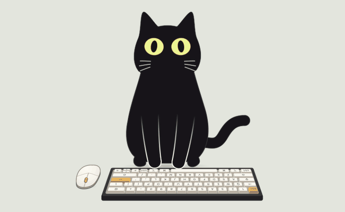
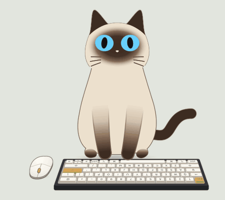
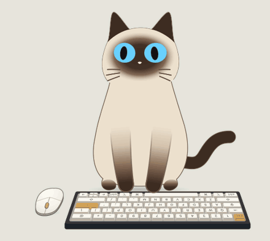

# Clack Clack

你敲键盘，它也敲键盘。你挪动鼠标，它就探过身子，伸爪握住自己的小鼠标。

Clack Clack 是一只住在 macOS 和 Windows 桌面上的键鼠同步桌宠。你可以让黑猫、暹罗猫，或橘白虎斑「黄粽子」来陪班。换猫时，新来的会从左边走过来，两只猫顶着额头对峙三秒，等上一只离开，它才走到键盘前坐下。

### 换动画班

### 工作日常

| 敲键盘 | 移动鼠标 |
| --- | --- |
|  |  |

## 灵感来源

Clack Clack 的桌宠创作灵感来自抖音博主「米粒」的作品《有人能get到吗🐱》。[在抖音观看原视频](https://v.douyin.com/m3M7uIbyQx0/)

## 下载与安装

打开本仓库的 **Releases**，在版本页的 **Assets** 中按电脑型号选择安装包。

| 电脑 | 下载文件 | 首次使用 |
| --- | --- | --- |
| Apple 芯片 Mac（M 系列，macOS 12 或更新） | 以 `macOS-arm64.dmg` 结尾 | 打开磁盘映像，把 Clack Clack 拖入「应用程序」，再从那里启动。 |
| Windows 10 / 11，Intel 或 AMD 64 位电脑 | 以 `Windows-x64-setup.exe` 结尾 | 运行安装向导，从开始菜单启动。首次使用可能需要联网安装 Microsoft Edge WebView2。 |

`arm64` 表示这个 Mac 安装包里的应用是为 Apple 芯片编译的。点苹果菜单  →「关于本机」，如果「芯片」一栏显示 Apple M 系列，就选这个 DMG；如果「处理器」一栏显示 Intel，则需要 Intel 或通用版，当前发布仅提供 Apple 芯片版。

当前 Mac 版使用本地证书签名，尚无 Apple 公证，首次打开可能被系统拦截。Windows 安装包尚未签名，系统可能提示发布者未知。Windows 版已完成安装包内容校验，真实设备上的键鼠同步仍待验证。

## 让猫跟着你动

- **macOS** 首次启动后，在「系统设置 → 隐私与安全性 → 输入监控」开启 Clack Clack，按系统提示重新打开应用。macOS 12 对应入口为「系统偏好设置 → 安全性与隐私 → 隐私 → 输入监控」。
- **打开设置** 右键点击 macOS 菜单栏或 Windows 通知区域里的猫头图标。
- **换猫和声音** 在「通用 → 外观与动效 → 猫咪品种」里选猫。想安静地看它们对峙，可以关闭「对峙配音」。想直接换猫，可以关闭「交换动画」。
- **共享屏幕时** 开启「隐私模式」，观众看到的是双爪轻拍，具体键位和键名会隐藏。也可以暂停键鼠同步。

键鼠事件在本机驱动动画。Clack Clack 不读取剪贴板或输入法文字，不保存按键历史，也不上传输入内容。
